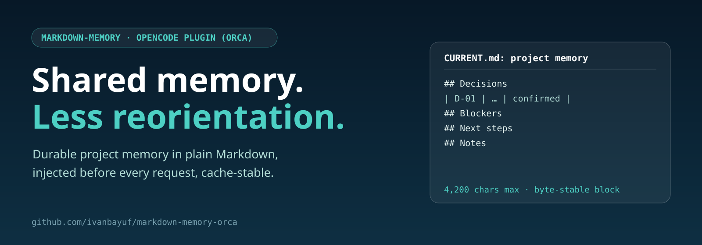

# markdown-memory-orca



[How it works](docs/HOW_IT_WORKS.md) · [Benchmark evidence](docs/BENCHMARKS.md) · [RTK and Graphify comparison](docs/COMPARISON.md)

Shared file-based external memory for AI coding agents.

## Problem → Why → How

**Problem.** A setup with many agents (UX bot, Dev bot, workers) across many sessions: every session starts blank. Each one re-reads files and re-derives context to orient — a ~12k-token native system prompt plus repeated exploration, paid again and again — and decisions made in one session or by one bot are lost to the next. Nothing persists; everything is re-derived or re-explained.

**Why this solution** (and not the obvious alternatives):

- *Re-explaining manually* (static CLAUDE.md-style notes) — works, but manual, so it goes stale, and agents cannot update it themselves.
- *Embeddings/RAG database* — durable, but heavy: infra, indexing, non-deterministic recall, and unreadable to humans.
- *Reuse the chat transcript* (the markdown-memory-hermes approach) — wrong layer for this host: opencode has no pre-send seam to drop history, and a transcript is noise, not knowledge. Amnesia *between* sessions is not a transcript problem.

That pins the requirements the design must satisfy: agents write it themselves (else stale), saving/recall are deterministic scripts with zero LLM calls (else it costs and hallucinates), the store is plain markdown (readable, editable, greppable, committable), the injection is a tiny byte-stable prefix (~200 tokens, constant) so provider prompt caches keep hitting instead of re-billing, and everything fails open — broken memory can never break a session.

**How.** Two independent layers:

1. **Engine** (`plugin/lib/`) — pure TypeScript over markdown, knows nothing about opencode. Project resolution → `~/memory/PROJECTS/<slug>/`; `save/update/read/search` (append-only HISTORY, auto-incremented decision IDs with explicit supersede, term-score search); injection builder (role-filtered, mtime-cached, content-hashed).
2. **Adapter** (thin, per host) — opencode hooks: inject the block before every request, nudge compaction to preserve decisions, register the `memory` tool. Mounting is one symlink; the on/off/auto markers (`bin/memory`, or the Orca Memory panel) toggle whether the engine loads at all.

**What is it:** an agent plugin that gives coding agents a shared, file-based external memory — plain Markdown under `~/memory` — injected as a compact, cache-stable block before every model request, plus a `memory` tool (save / update / read / search).

**Problem:** agents restart with no durable knowledge; every session re-reads files to re-orient, bloating context, and decisions made in one session or by one bot are lost to the next.

**Goal:** compact role-aware project memory (CURRENT / HISTORY / ARCHIVE per project, GLOBAL preferences), deterministic updates with no extra LLM calls, on-demand retrieval, byte-stable injection so provider prompt caches keep hitting, reversible per-project install.

**Impact:** ~200-token injection vs a ~12k-token native system prompt; cross-session prompt-cache hits verified on opencode-go; decisions persist with explicit supersede (never silently overwritten); 14 unit tests + 19 reliability checks including real compaction and cross-project isolation.

**Measured 2026-11-24 (reproducible fixtures, `benchmarks/`):** injected block 1,381 chars (~346 est. tokens) small, 2,881 (~721) medium, capped at 4,200 (~1,050) large; byte-stable across 10 calls per fixture, hash busts on exactly one edit. Tokens are `ceil(chars/4)` estimates, not provider counts. The earlier 121–287-token range and the n=3 A/B (which measured *higher* cost with memory) are prior measurements, kept with their caveats in [Benchmark evidence](docs/BENCHMARKS.md).

## Not OpenCode-specific

Correct — OpenCode is only the first *mounting point*. The engine is two
independent layers:

1. **The engine** (`plugin/lib/`) is plain TypeScript + Node built-ins over
   Markdown files. It knows nothing about OpenCode, the model, or the provider:
   project resolution, injection building, save/update/search, metrics.
   Model-agnostic by construction: everything it does is deterministic text
   processing — no LLM calls, no provider APIs.
2. **A thin mounting adapter** per agent CLI that owns the hooks for that
   tool. Each adapter is small because every major agent CLI already has a
   hook system:

| Agent CLI | Adapter status | Hook used |
|---|---|---|
| OpenCode | **implemented** (this repo) | `experimental.chat.system.transform` (V1 form of the V2 `session.hook("context")`), `experimental.session.compacting` |
| Claude Code | designed, not implemented | `SessionStart` (+`compact` matcher), `UserPromptSubmit` |
| Codex CLI | designed, not implemented | `hooks.json`: `SessionStart`, `PostCompact` |
| Any model | works as-is | the block is plain prompt text; prompt caching is a bonus, not a requirement |

Any IDE or orchestrator that drives those CLIs (terminal, TUI, or headless
`run`/`serve` modes) gets the same memory, because the hooks fire in the CLI,
not in the GUI.

## How it differs from rtk and graphify

The three tools solve different context problems and compose cleanly:

| | This engine | rtk | graphify |
|---|---|---|---|
| Layer | **before every model request** (system prompt) | **at tool execution** (command output) | **on demand** (agent-invoked queries) |
| Domain | durable *state*: what was decided, what's blocked, what's next | *the present*: compresses command/tool output tokens as they happen | *structure*: codebase/docs knowledge graph for query & explain |
| Lifetime | cross-session, cross-bot | per command call | persisted index, queried per session |
| Cost model | ~200-token stable prefix, cache-friendly | smaller tool results | one-off heavy queries, results are agent-read |

Running together in one session: the memory block (this engine) orients the
agent instantly; when it needs architecture understanding it queries graphify
instead of re-reading the tree; every command it runs gets compressed by rtk.
A natural loop: memory says "this was decided yesterday" → graphify answers
"where does X live" → rtk keeps the tool output cheap → the agent saves the
distilled conclusion back with `memory save discovery` (store the conclusion,
never the whole graph or raw dumps).

## Storage

```text
~/memory/
├── GLOBAL.md                  # durable user preferences + conventions
├── .metrics/opencode.jsonl    # per-request injection metrics (this plugin)
└── PROJECTS/
    ├── INDEX.yaml             # optional slug aliases (repo basename -> slug)
    └── <slug>/
        ├── CURRENT.md         # living state: decisions, goals, blockers, next steps
        ├── HISTORY.md         # append-only meaningful events (with session refs)
        └── ARCHIVE/           # rotated snapshots; searched on demand, never loaded eagerly
```

Default slug = git repository root basename; repositories without a Git root
fall back to the directory basename. `INDEX.yaml` aliases override.

Roles (`MEMORY_ROLE` env or `role` option): `ux | ui | dev | orchestration | general`.
Sections wrapped in `<!-- memory:roles="ux,ui" --> ... <!-- /memory:roles -->`
are injected only to matching roles; `orchestration` sees everything; untagged
content is shared by all roles.

## Install

### Global (all projects, including future ones — recommended)

OpenCode auto-loads every plugin in `~/.config/opencode/plugins/`. One symlink
activates memory everywhere, with no per-project configuration:

```sh
ln -sfn ~/code/markdown-memory-orca/plugin/memory-engine.ts ~/.config/opencode/plugins/markdown-memory.ts
```

Back up that directory first (`cp -R ~/.config/opencode/plugins ~/.config/opencode-backups/`).
To run isolated experiments without touching real memory, override the root
per run: `MEMORY_ROOT=/tmp/mem-root opencode run …` (the env also beats
`~/memory` inside the global mount). Rollback = delete the symlink.

### Auto-run toggle

Turn the engine on or off for every future session — no symlink surgery, no
restarts. Two markers in the memory root decide the mode:

```sh
bin/memory status     # memory: ON|OFF, auto-inject: ON|OFF
bin/memory off        # no tool, no injection (marker: ~/memory/.disabled)
bin/memory on         # tool + injection
bin/memory auto off   # tool stays, injection stops (marker: ~/memory/.auto-off)
bin/memory auto on    # injection resumes
```

The same markers are toggled by the Orca sidebar panel (`memory-panel/` in
this repo: a trusted-worker plugin whose worker owns the markers and mirrors
CLI flips live).

(Ongoing sessions keep their current state; the mode is read when a session
boots.)

### Per-project (alternative)

In the project's `opencode.json`:

```json
{
  "plugin": [["~/code/markdown-memory-orca/plugin/memory-engine.ts", { "memoryRoot": "~/memory" }]]
}
```

Note: `~` expands inside `memoryRoot` (handled by the plugin), but the plugin
*path* entry needs an absolute path. Rollback = remove the entry.

## Rollback

Remove the `plugin` entry from that project's `opencode.json`. Nothing else is
modified: no sessions, no session database, no global config. Memory files
under `~/memory` are never deleted by the plugin (HISTORY is append-only).

## Behavior notes

- Injection is byte-identical until a source file changes (the block carries a
  SHA-1 hash; re-reads are gated on file mtime+size) — required for provider
  prompt-cache hits; verified against opencode-go (`cache.read` in session tokens).
- The plugin hook fires twice per request in opencode 1.19.6; a guard keeps
  exactly one block.
- `experimental.session.compacting` adds a preservation instruction to the
  compaction prompt so summarized context keeps project decisions/blockers.
- All hooks and the tool fail open: any error logs to the opencode log and the
  native context proceeds untouched.

## Benchmark

All numbers measured on opencode-go / GLM-5.3-Flash; harness in `test/`.

### Injection overhead (measured)

- Injected block: **121–287 tokens** per request (mean ≈ 210) against a
  ~12.4k-token native system prompt — **≈ 1.7% of prompt size**, constant.
- Zero extra LLM calls: memory writes and search are deterministic scripts.

### Prompt-cache behavior (measured)

The injected block is byte-stable until a memory file changes, so provider
prompt caches keep hitting:

- Example session (turns 1→3): fresh input **18,289 → 1,170 tokens**, with
  **17,408 cache-read** on the final turn (−94% fresh input once the prefix is
  cached).
- Cross-session hits: a brand-new session in the same project re-hits the
  cache when the memory block is unchanged (same content hash).
- A memory write busts the cache for exactly one request, then hits resume —
  verified deliberately (mid-session decision save).
- Honest caveats: `cache.write` is never reported by this provider, and **a
  cache hit is not a saving** — cached tokens still cost ~10% of full price.

### A/B micro-benchmark (n = 3, scripted tasks)

| Metric | Baseline (`--pure`) | With memory |
|---|---|---|
| Sessions / turns | 3 / 6 | 3 / 9 (+1 memory-write turn per session) |
| Input tokens | 50,820 | 72,516 |
| Cache-read tokens | 48,960 | 93,584 |
| Mean input / turn | 8,470 | 8,057 |
| Cost | $0.0093 | $0.0140 |
| Tool calls | read ×6 | read ×6 + memory ×3, 0 errors |
| Reliability checks | — | 19/19 (compaction, resume, roles, supersede, isolation, fail-open) |

Read this honestly: the variants do different work (the memory variant also
writes a discovery), n = 3 is noise, and the with-memory cost is *higher* in
this shape. The injection overhead is real and constant; the pay-off has to
come from agents skipping repeated re-orientation (fewer file re-reads and
fewer sessions per task), which is tracked separately during real-world pilot
usage rather than claimed from this micro-benchmark.

### Reproduce

```sh
node --test test/     # 14 unit tests (or: npm install && npm test)
./test/phase4.sh      # 19 reliability checks
./test/phase5.sh      # A/B benchmark (writes to testbed only)
```

## Tests

```sh
npm install   # first time: installs @opencode-ai/plugin + zod
npm test      # node --test test/engine.test.ts
```

## License

MIT
