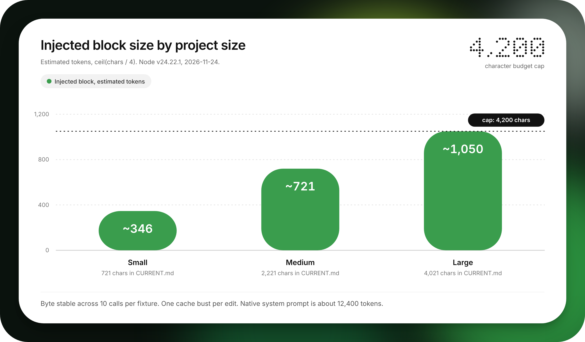

# Benchmark evidence and reproduction

## Measured 2026-11-24 (reproducible, engine-level fixtures)



Harness: `benchmarks/bench_orca.mjs` (imports `plugin/lib/` only, no
OpenCode, no provider, no LLM), results in
`benchmarks/results/orca-2026-11-24.json`. Run it yourself:

```sh
node benchmarks/bench_orca.mjs
```

**Fixtures (deterministic, generated by the harness):** `GLOBAL.md` ~400
chars in every case; `CURRENT.md` small ~500 / medium ~2,000 / large ~3,800
chars; role `general`; budget 4,200 chars (the plugin default). Node v24.22.1.

| Fixture | `CURRENT.md` chars | Injected chars | Est. tokens (`ceil(chars/4)`) |
|---|---|---|---|
| small | 721 | 1,381 | **~346** |
| medium | 2,221 | 2,881 | **~721** |
| large | 4,021 | 4,200 (capped) | **~1,050** |

**Cache behaviour (all fixtures):** byte-stable across 10 calls (one hash);
hash busts on exactly one edit, then re-stabilises. Cached build median
~0.01 ms, uncached ~0.02 ms (20 / 5 runs, in-process, sub-millisecond; the
cost is the request payload, not the build). Empty memory injects `null`.

**What the numbers mean:** the injected block is the engine's *overhead*,
2.8–8.5% of the ~12,400-token native system prompt reported in the README
(prior measurement, not re-run here). Tokens here are the plugin's own
`ceil(chars/4)` estimate, **not** tokenizer or provider counts. A large
`CURRENT.md` hits the 4,200-char cap exactly: the tail is never injected, and
edits past the truncation point do not change the block (or bust the provider
cache) until earlier content shrinks.

**Determinism:** chars, hashes, and bust behaviour are identical across runs
(verified 2026-11-24); only the sub-millisecond timings vary.

## Prior README measurements (not re-run here)

- **Injection overhead:** 121–287 tokens per request (mean ≈210) against a
  ~12.4k-token native system prompt, about 1.7% of prompt size, constant. These
  are the author's measurements on their real (smaller) memory files; the
  fixtures above are larger, hence the larger numbers. Both rest on the
  `chars/4` estimate.
- **Prompt-cache behaviour:** example session (turns 1→3) fresh input
  18,289 → 1,170 tokens with 17,408 cache-read on the final turn (−94% fresh
  input once the prefix is cached); cross-session re-hits when the block is
  unchanged; one bust per memory write, then hits resume. Caveats, kept from
  the README: `cache.write` is never reported by this provider, and **a
  cache hit is not a saving**: cached tokens still cost about 10% of full price.
  These numbers come from the opencode SQLite session DB; no session
  log/export is committed, so they are not reproducible from the repo.
- **A/B micro-benchmark (n=3, scripted tasks):** baseline 50,820 input
  tokens / $0.0093 vs with-memory 72,516 / $0.0140. The with-memory arm cost
  *more*, because the variants did different work (the memory arm also wrote
  a discovery: 9 turns vs 6). Read honestly: n=3 is noise, and the injection
  overhead is real and constant; the pay-off has to come from agents skipping
  repeated re-orientation (fewer file re-reads, fewer sessions per task),
  which is tracked during real-world pilot usage rather than claimed from
  this micro-benchmark.

## What tests establish (and what they don't)

Unit suite (`node --test test/engine.test.ts`, or `npm test`): **14 tests,
all passing 2026-11-24** (13 original + 1 regression test for the failed-save
HISTORY fix). They cover project resolution, role filtering, injection
determinism/hash/budget/null-when-empty, save/supersede, update, search, read
tail, init, and the `.disabled` toggle. The `.disabled` test failed in a clean
checkout before this update (missing `@opencode-ai/plugin`, no `package.json`
existed); `npm install` fixes it.

They do **not** cover the transform/compacting hooks themselves, `metrics.ts`,
`bin/memory`, malformed alias/role regions, concurrent-write races, or any
provider-token assertion. No test counts provider tokens.

`test/phase4.sh` (19 reliability checks) and `test/phase5.sh` (A/B) are
manual zsh harnesses, not run by `node --test`. They need `opencode serve/run`,
`sqlite3`, a macOS/zsh environment, and the `opencode-go/glm-5.3-flash`
provider, and were not run in this update.
