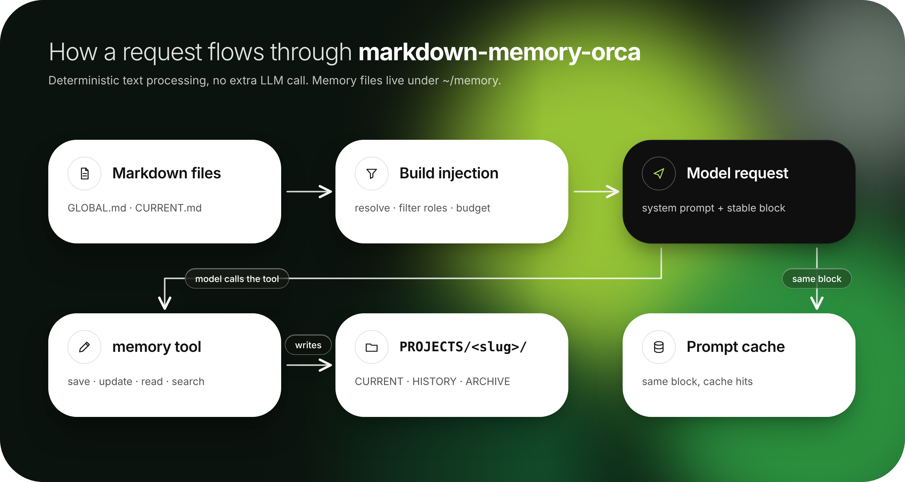

# How markdown-memory-orca works



An OpenCode plugin that gives coding agents shared, file-based external
memory — plain Markdown under `~/memory` — injected as a compact,
cache-stable block before every model request, plus a `memory` tool
(`save` / `update` / `read` / `search`). The engine (`plugin/lib/`) is plain
TypeScript + Node built-ins over Markdown files; it knows nothing about
OpenCode, the model, or the provider. OpenCode is only the first mounting
point: the adapter (`plugin/memory-engine.ts`) owns the hooks.

## The three seams

| Seam | When it runs | What it does |
|---|---|---|
| `experimental.chat.system.transform` | Before every model request | Appends the memory block to the system prompt (once — a guard handles the hook firing twice per request in OpenCode 1.19.6) |
| `experimental.session.compacting` | When a session compacts | Adds one preservation sentence naming `CURRENT.md`, asking the summary to keep decisions/blockers/pending work |
| `memory` tool | When the model (or user) calls it | `save` / `update` / `read` / `search` against the Markdown store |

## Request lifecycle

1. **A session starts** — the plugin resolves the project (nearest ancestor
   with `.git` → repo basename; no git → directory basename; `INDEX.yaml`
   `aliases:` override) and the memory root (`memoryRoot` option >
   `MEMORY_ROOT` env > `~/memory`). If `~/memory/.disabled` exists (see
   `bin/memory off`), the plugin returns `{}` — fully inert for that session.
2. **Before every model request**, `buildInjection` reads `GLOBAL.md` +
   project `CURRENT.md`, filters by role, wraps them in
   `<global-memory>` / `<project-memory project="slug">` tags with the header
   `External memory (engine: markdown-memory, project: <slug>[, role:
   <role>]).`, and pushes the block onto the system prompt.
3. **The block is byte-identical until a source file changes** — it carries a
   SHA-1 hash (first 12 hex chars), and re-reads are gated on file
   mtime+size. That stability is what lets provider prompt caches keep
   hitting. Measured: identical hash across 10 calls per fixture; exactly one
   bust after an edit, then stable again (see `docs/BENCHMARKS.md`).
4. **The model needs more, or has something to keep** — it calls the `memory`
   tool. `save` writes a decision / milestone / discovery / issue /
   requirement; `search` greps `GLOBAL.md`, `HISTORY.md`, and `ARCHIVE/*.md`
   deterministically (no LLM); `read` returns a whole file or a history tail.
5. **Across sessions and restarts**, the files are the memory — a new session
   in the same project injects the same block and re-hits the cache when
   nothing changed.

## The files (under `~/memory/`)

```text
~/memory/
├── GLOBAL.md                  # durable user preferences + conventions
├── .metrics/opencode.jsonl    # per-request injection metrics (this plugin)
└── PROJECTS/
    ├── INDEX.yaml             # optional slug aliases (repo basename -> slug)
    └── <slug>/
        ├── CURRENT.md         # living state: decisions, goals, blockers, next steps
        ├── HISTORY.md         # append-only meaningful events (with session refs)
        └── ARCHIVE/           # rotated snapshots; searched on demand, never loaded eagerly
```

- **`CURRENT.md`** — `# <slug> — project memory`, `Last updated: <ISO>`, a
  `## Decisions` table (`| ID | Date | Decision | Status | Supersedes |`,
  ids `D-01`, `D-02`, …), then `## Goals` / `## Blockers` / `## Next steps` /
  `## Notes`. Decisions are one line in the table (≤200 chars, `|` escaped);
  the full text lives only in `HISTORY.md`.
- **`HISTORY.md`** — append-only `## <ISO> <kind> <status> [session:<id>]`
  entries with the full content. A failed `save` writes nothing here (fixed
  2026-11-24 — an earlier version appended to HISTORY *before* validating a
  supersede target, so failed saves left entries claiming something was saved).
- **`GLOBAL.md`** — shared preferences, injected for every project.

## The `memory` tool

- **`save`** — `kind` required (`decision|milestone|discovery|issue|
  requirement`), `status` defaults to `confirmed`
  (`confirmed|assumption|proposal`). Decisions get the next `D-NN` id and a
  table row; `supersedes: "D-xx"` rewrites the old row's status to
  `superseded by D-NN` (only confirmed decisions can be superseded; missing
  or non-confirmed targets throw and nothing is written). Other kinds mirror
  into a section (`requirement→Goals`, `issue→Blockers`, else `Notes`) as a
  dated bullet. `scope`, if given, must equal the resolved project slug for
  *all* actions — even `read`/`search` — or the tool refuses.
- **`update`** — rewrites a whole section body (`Goals|Blockers|Next steps|
  Notes`; never Decisions). **This is destructive and unaudited**: no append,
  no HISTORY entry. Use it to rewrite, not to add — `save` is the append path.
- **`read`** — `target=current|global|history`, `lines` (history only,
  default 120). `current`/`global` return the **whole file, unbounded**.
- **`search`** — deterministic substring scoring over lowercase words (≥2
  chars) in `GLOBAL.md`, `HISTORY.md`, and top-level `ARCHIVE/*.md` only —
  **`CURRENT.md` is not searched**. Paragraphs ≥24 chars, scored by
  occurrence count, excerpts capped at 600 chars, total capped by
  `budgetChars` (default 1,500).

## Roles and budget

- Roles (`MEMORY_ROLE` env or `role` option): `ux | ui | dev | orchestration
  | general` (default `general`). Sections wrapped in
  `<!-- memory:roles="ux,ui" --> … <!-- /memory:roles -->` are injected only
  to matching roles; `orchestration` sees everything; untagged content is
  shared. An **unclosed region swallows the rest of the file** for
  non-matching roles.
- Budget: default **4,200 chars**. The body is truncated first, then the
  whole block is truncated again if still over — the double truncation can cut
  mid-token/mid-tag. Measured cap behaviour: a large fixture (4,021 chars of
  `CURRENT.md`) injects exactly 4,200 chars / ~1,050 estimated tokens. Edits
  past the truncation point do not change the injected block at all (and do
  not bust the provider cache) until earlier content shrinks.
- Tokens are **estimates**: `tokensEstimate = ceil(chars / 4)`. The metrics
  log and the README's token figures rest on that estimate, not on a
  tokenizer or provider counts.

## Auto-run toggle and metrics

- `bin/memory off|on|status` drops/removes `~/memory/.disabled`. The toggle
  is read when a session boots; ongoing sessions keep their current state.
- Every injection / compaction / tool call appends one JSON line to
  `<root>/.metrics/opencode.jsonl` (unbounded, no rotation or locking).
  Write failures only log to console.

## Fail-open by design

All hooks and the tool fail open: any error logs and the native context
proceeds untouched. Empty memory injects nothing (`null` — verified by the
benchmark harness). A session with no memory files behaves natively.

## Limits — read these before relying on the engine

- **Injection is overhead, not savings, by itself.** The block costs ~350–
  1,050 estimated tokens per request (measured fixtures); the pay-off has to
  come from agents skipping repeated re-orientation (fewer re-reads, fewer
  sessions per task). The repo's own A/B (n=3) measured *higher* cost with
  memory on — see `docs/BENCHMARKS.md` for the honest read.
- **`updateSection` silently replaces a whole section** (see above).
- **No write locking.** Two sessions doing read-modify-write on `CURRENT.md`
  can lose updates or duplicate `D-NN` ids.
- **Cache validity is mtime+size, not content.** Same-size content rewritten
  within the same `mtimeMs` would serve stale; a `touch` with identical
  content recomputes but keeps the same hash.
- **`search` does not search `CURRENT.md`**, and `read` of current/global is
  unbounded.
- **No `package.json` existed before this update** — the plugin imports
  `@opencode-ai/plugin` and `zod` with no manifest, so a clean checkout could
  not run the `.disabled` test. Added 2026-11-24 (`package.json`,
  `tsconfig.json`, `package-lock.json`; `npm install` then `npm test`).
- **The tracked `node_modules` symlink is removed in this update** — it
  pointed at a personal macOS path (`/Users/ivanbayu/.config/opencode/
  node_modules`) and was broken on any other machine.
- **Phase 4/5 harnesses are manual, not CI.** They hardcode macOS/zsh paths,
  `opencode serve/run`, `sqlite3`, and the `opencode-go/glm-5.3-flash`
  provider, and are not portable as-is. The unit suite (`node --test`) is
  portable and is what CI should run.
