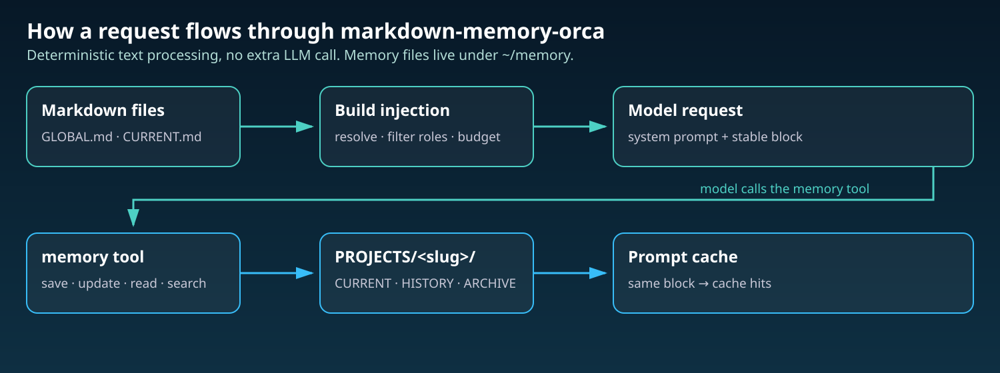

# How markdown-memory-orca works

## Purpose

Orca is a shared, file-backed project memory adapter for OpenCode. It keeps durable project state in plain Markdown and exposes a `memory` tool for deliberate saves and retrieval. It orients each request with a compact working snapshot; it does not replace the conversation transcript or build a code dependency graph.

## Request path

1. OpenCode calls the system-transform hook before a model request.
2. The plugin resolves the project from the worktree, with directory fallback and optional slug aliases.
3. It reads global preferences and that project's `CURRENT.md`, applies role markers, and enforces the configured character budget.
4. It appends an external-memory block to the system prompt. A duplicate-hook guard avoids appending twice when the host invokes the transform twice.
5. It records injection metadata in a JSONL metrics file. On hook errors, it logs and lets the native request continue.

The default budget is 4,200 characters (roughly 1,050 tokens under the code's chars/4 estimate). The README's smaller observed figure describes an example, not the default or a guarantee.

## Storage and edits

- `GLOBAL.md`: preferences and conventions shared across projects.
- `PROJECTS/<slug>/CURRENT.md`: active decisions, goals, blockers, notes, and next steps.
- `PROJECTS/<slug>/HISTORY.md`: append-only meaningful events.
- `PROJECTS/<slug>/ARCHIVE/`: snapshots available to search, not eagerly injected.

The tool supports save, update, read, and search. Decision changes require an explicit supersedes reference; section updates cannot rewrite the decisions table. Search is deterministic term matching, not semantic retrieval. Memory writes are scoped to the current project.

## Compaction, limits, and evidence

The compaction hook asks the host to preserve decisions, blockers, and pending work. Hooks are designed to fail open so memory errors do not prevent the native request.

This repository implements the OpenCode adapter; adapters for other CLIs mentioned in the README are plans, not shipped integrations. The implementation details here are based on `plugin/memory-engine.ts`, `plugin/lib/inject.ts`, `plugin/lib/store.ts`, and the README.

